<!-- omit in toc -->
# 11. Kiro Brownfield IaC 検証記録 / 実務 Runbook

> **Status:** Draft v0.1
> **作成日:** 2026-10-11
> **対象:** `rails-aws-sre-lab` / `rails-aws-sre-lab-kiro`
> **検証テーマ:** 既存 Terraform を Kiro に見せず、AWS 実環境の Read-only Discovery から Terraform を再生成し、別環境として再構築できるか
> **最終成功条件:** `https://kiro.saxon-aws-lab.click/tasks` へ HTTPS でアクセスし、Rails アプリが HTTP 200 で正常表示されること

---

<!-- omit in toc -->
## 目次

- [0. 目的](#0-目的)
- [1. 検証の背景](#1-検証の背景)
- [2. 検証ルール](#2-検証ルール)
- [3. 検証フェーズ](#3-検証フェーズ)
- [4. Kiro 環境の準備](#4-kiro-環境の準備)
- [5. 分析用 Role](#5-分析用-role)
- [6. 分析開始前の疎通確認](#6-分析開始前の疎通確認)
- [7. Discovery Prompt](#7-discovery-prompt)
- [8. 初回の分析結果](#8-初回の分析結果)
- [9. Human Review: Discovery Gap の評価](#9-human-review-discovery-gap-の評価)
- [10. Supplemental Discovery Policy](#10-supplemental-discovery-policy)
- [11. 再 Discovery](#11-再-discovery)
- [12. 残った Discovery Gap](#12-残った-discovery-gap)
- [13. Terraform Generation への Human Approval](#13-terraform-generation-への-human-approval)
- [14. Kiro による Terraform Generation](#14-kiro-による-terraform-generation)
- [15. Kiro の Terraform Validation](#15-kiro-の-terraform-validation)
- [16. GitHub PR](#16-github-pr)
- [17. Original Terraform vs Kiro Generated Terraform](#17-original-terraform-vs-kiro-generated-terraform)
- [18. Original Terraform と異なる重要ポイント](#18-original-terraform-と異なる重要ポイント)
- [19. Kiro の精度評価](#19-kiro-の精度評価)
- [20. Human Intervention 一覧](#20-human-intervention-一覧)
- [21. Secret / Artifact Responsibility](#21-secret--artifact-responsibility)
- [22. RAILS\_MASTER\_KEY とは](#22-rails_master_key-とは)
- [23. Terraform State 方針](#23-terraform-state-方針)
- [24. Discovery Role と Deployment Role の分離](#24-discovery-role-と-deployment-role-の分離)
- [25. 今後の Deployment Runbook](#25-今後の-deployment-runbook)
- [26. Kiro Deployment Prompt の設計方針](#26-kiro-deployment-prompt-の設計方針)
- [27. Terraform初回Deployの論点](#27-terraform初回deployの論点)
- [28. Apply 前の追加 Review 項目](#28-apply-前の追加-review-項目)
- [29. Cost / Credits 記録](#29-cost--credits-記録)
- [30. Cleanup Runbook](#30-cleanup-runbook)
- [31. 実務で再利用する場合の標準フロー](#31-実務で再利用する場合の標準フロー)
- [32. 現時点の結論](#32-現時点の結論)
- [33. ブログ記事へ展開する場合の構成案](#33-ブログ記事へ展開する場合の構成案)
- [34. 画像候補一覧](#34-画像候補一覧)
- [35. 今後追記する内容](#35-今後追記する内容)

---

# 0. 目的

このドキュメントは、
Kiro を利用して既存 AWS 環境を Brownfield IaC 化する検証結果をまとめたものである

> Brownfield IaC 化：既存の AWS 環境をゼロから新規設計するのではなく、現在稼働しているリソース構成・依存関係・設定を調査し、それを Terraform などの IaC コードとして再構築可能な形に落とし込むこと
>
> 新規環境をゼロから構築する Greenfield に対し、既存環境を解析してIaC化するアプローチを Brownfield と呼ぶ

---

# 1. 検証の背景

## 1.1 これまでの `rails-aws-sre-lab`

既存の `rails-aws-sre-lab` では、
Rails アプリを AWS 上で稼働させるための環境を Terraform で管理している

システムの主要構成は以下となる

```text
Internet
   │
   ▼
Route 53
   │
   ▼
Application Load Balancer
   │ HTTPS termination
   ▼
Target Group :8080
   │
   ▼
ECS Fargate
   │
   ├── ECR
   ├── Secrets Manager
   ├── CloudWatch Logs
   │
   ▼
RDS PostgreSQL
```

Terraform で管理しているリソース一覧:

- ECS Fargate (ARM64, CPU 256 / Memory 512 MiB)
- ECS Application Auto Scaling
- ALB
- RDS PostgreSQL
- VPC Endpoint (NAT Gateway 未使用)
- Secrets Manager
- CloudWatch Logs
- Route 53 / ACM
- Terraform Remote State (S3 Bucket)
- CloudWatch Dashboard / Alarm
- SNS / Amazon Q Developer (Slack 通知)
- EventBridge (ECS Event Capture)
- AWS DevOps Agent

---

## 1.2 今回のテーマ

今回の検証では、
**既存 Terraform を Kiro に一切見せずに、システムの機能を再現できる IaC コードを生成させる**
ことを目標とする

Kiro が参照してよいものは、原則として以下のみとする

- AWS 実環境
- プロンプト（人間が定義した IaC 化における要件や制約）

Kiro に以下を実施させる

```text
AWS API による環境調査（Read-only Discovery）
        ↓
リソースの一覧化
        ↓
依存関係の調査
        ↓
アーキテクチャの理解
        ↓
IaC 化対象の判断
        ↓
Kiro が提示した IaC 化計画の人間によるレビュー・承認
        ↓
Terraform 生成
        ↓
fmt / validate / plan
        ↓
Kiro が生成した IaC の人間によるレビュー・承認
        ↓
デプロイ（apply）
        ↓
End-to-End バリデーション・テスト
```

---

# 2. 検証ルール

## 2.1 Kiro に見せないもの

以下は IaC 生成時に模範解答として使用される可能性があるため、Kiro には見せない

- 既存 `rails-aws-sre-lab` の Terraform
  - https://github.com/Saxon-Pi/rails-aws-sre-lab/tree/develop/terraform
- 既存 Terraform State
- Terraform の設計意図などを記載したメモやドキュメント類
- Rails ソースコード

Kiro が生成した IaC をプッシュする際は、専用プライベートリポジトリを使用させる

- Saxon-Pi/rails-aws-sre-lab-kiro
  - https://github.com/Saxon-Pi/rails-aws-sre-lab-kiro

---

## 2.2 Kiro に与えるもの

- AWS 実環境へのアクセス権限（Read-only）
- 対象リージョンの指定（`ap-northeast-1`）
- 新環境の要件（既存環境と分離すること等）
- タスクの目的（Terraform を生成すること）
- タスクの制約
  - 人間のレビュー・承認前に Apply しないこと
  - GitHub に branch / commit / push / PR を作成すること

---

## 2.3 既存環境と新環境の関係

IaC 化における解析対象は既存環境だが、生成した IaC のデプロイ先は別環境とする

```text
既存環境
VPC 10.0.0.0/16
        │
        │ 環境の解析（Read-only）
        ▼
      Kiro
        │
        │ Terraform 生成
        ▼
Kiro による新規環境
VPC 10.20.0.0/16
```

既存環境に対するデプロイや変更は行わない

---

# 3. 検証フェーズ

| Phase | 内容 | 主担当 | 状態 |
|---|---|---|---|
| 1 | Kiro / GitHub / AWS の準備・連携 | 人間 | ✅ 完了 |
| 2 | AWS 環境の解析 | Kiro | ✅ 完了 |
| 2.5 | Kiro が提示した IaC 化計画の調整 | 人間 + Kiro | ✅ 完了 |
| 3 | Terraform 生成 | Kiro | ✅ 完了 |
| 3.5 | 生成した IaC の人間によるレビュー | 人間 | 🔄 実施中 |
| 4 | デプロイのための Role / プロンプト の準備 | 人間 | ⏳ 未実施 |
| 5 | 第一段階デプロイ（ECR / Secrets Manager 等） | Kiro | ⏳ 未実施 |
| 6 | Application Artifact / Secret 投入 | 人間 | ⏳ 未実施 |
| 7 | 第二段階デプロイ / 検証 | Kiro | ⏳ 未実施 |
| 8 | 最終レビュー・承認 / 後片付け | 人間 | ⏳ 未実施 |

---

# 4. Kiro 環境の準備

## 4.1 Kiro Subscription

今回の検証では Kiro Pro を利用する

サブスクするとクレジットが付与され、  Kiro を実行するとタスクの量に応じてクレジットが消費される

検証開始時:

```text
0 / 1000 credits used
```

今後、以下のタイミングでクレジットを記録する

- AWS環境の解析前後
- Terraform 生成後
- terraform plan と修正後
- デプロイ後
- 最終合計

ダッシュボードやプロフィールからクレジットの使用状況を確認することができる
※ 画像は検証途中のクレジット状況

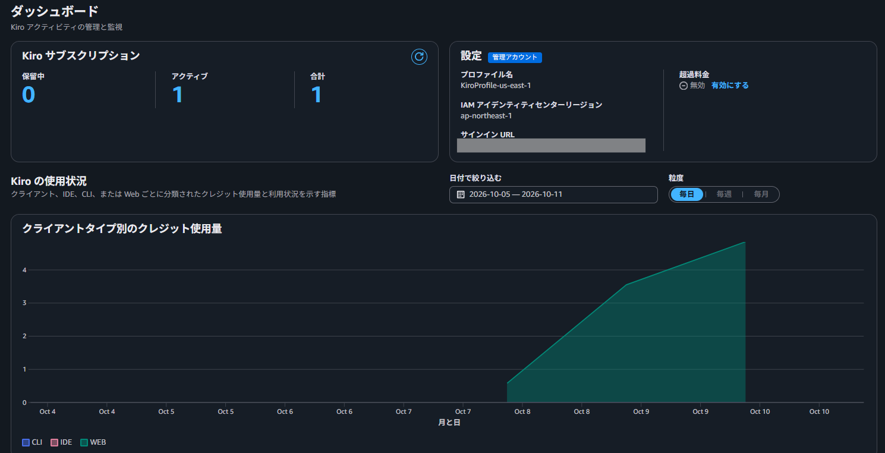

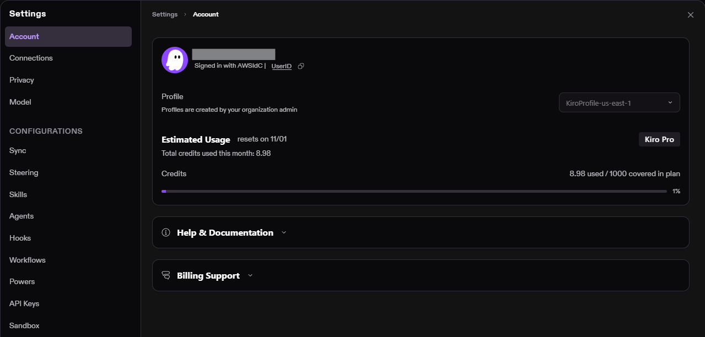

---

## 4.2 GitHub 接続

https://app.kiro.dev/ にサインインして、
Settings > Connections からGitHubリポジトリと連携する

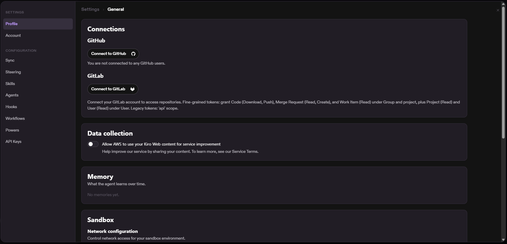

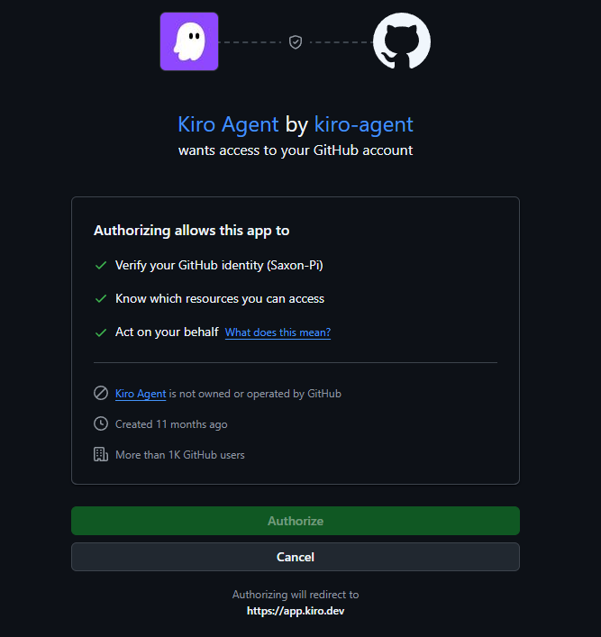

今回は専用プライベートリポジトリ（rails-aws-sre-lab-kiro）のみ連携する

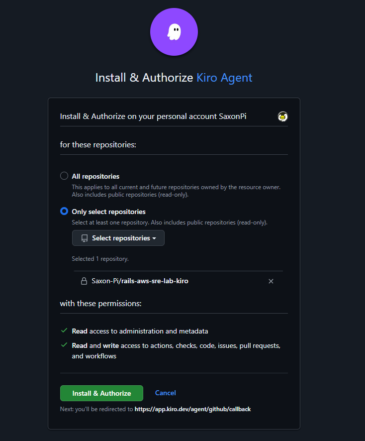

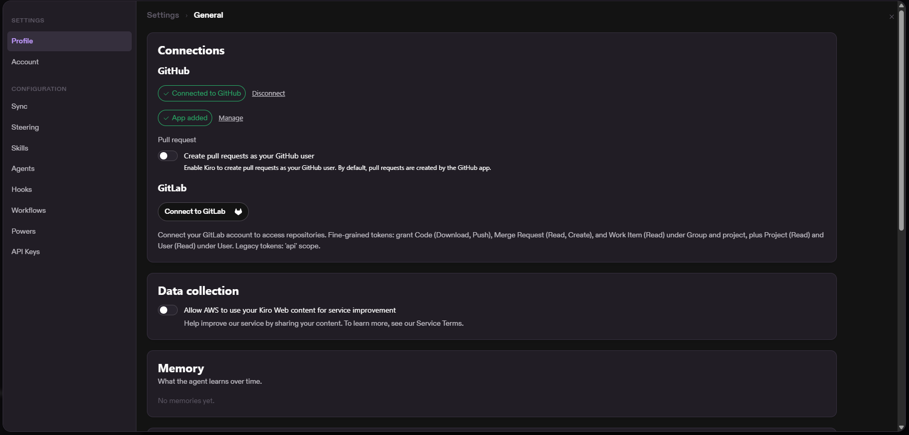

既存リポジトリ（`rails-aws-sre-lab`）へのアクセスは許可していないため、
Kiro は生成した IaC をプッシュする専用リポジトリにはアクセスできるが、
既存の Terraform を参照することはできない

---

## 4.3 Kiro Web の Sandbox 設定

最終的に Kiro を以下の設定にした

- GitHub: Connected
- クラウドセッション (Kiro Web): 有効化
- Network configuration Access level: Common dependencies
- AWS Credentials: 分析用 Role を付与

GitHub: Connected


クラウドセッション (Kiro Web): 有効化

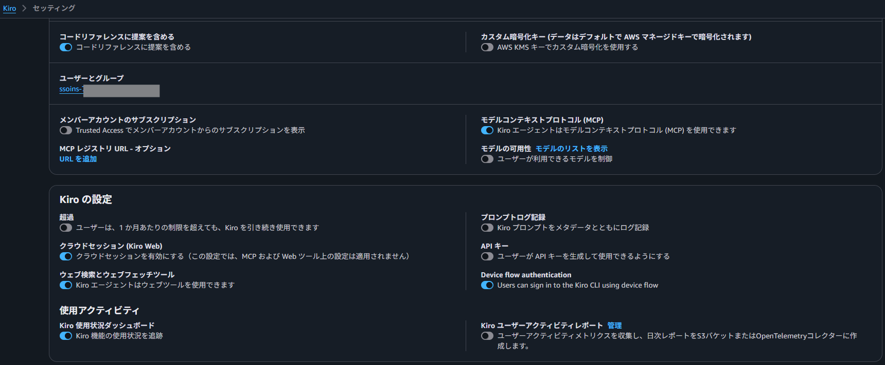

Network configuration Access level: Common dependencies
AWS Credentials: 分析用 Role を付与
→ [Role: rails-aws-sre-lab-kiro-discovery-role (kiro.tf)](../terraform/kiro.tf)

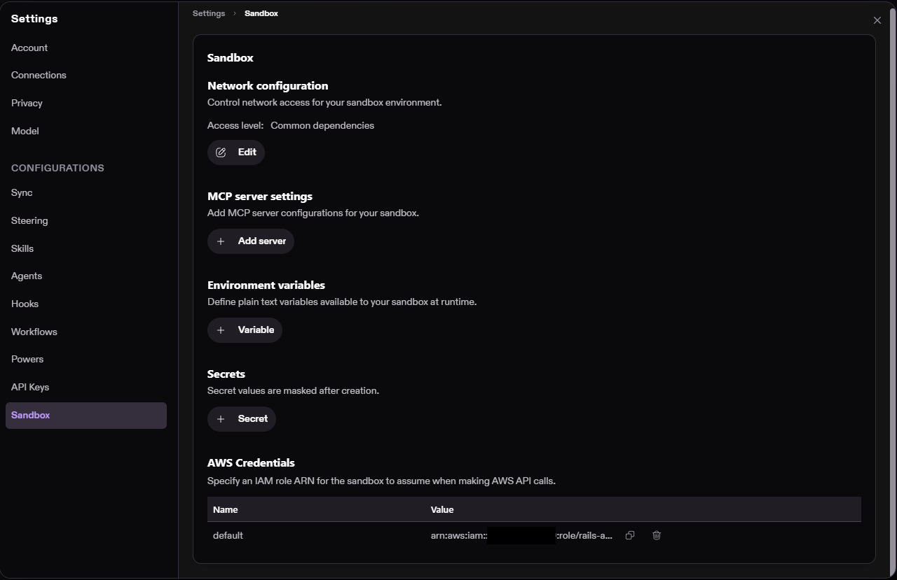

当初は Network configuration で `Repository access only` を設定していたが、
AWS API へのアクセス時に 403 が発生した

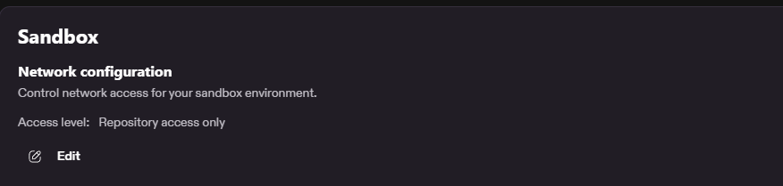

Kiro に既存環境の一部リソースを対象に分析を指示

.png)

AWS API へのアクセス時に 403 で拒否され、リソースの読み取りが失敗した

.png)

.png)

### 発生した問題

```text
Repository access only
├─ GitHub           OK
└─ AWS API          NG
```

Kiro 自身が managed proxy / allowlist による通信制限と切り分けた

.png)

そのため Network configuration を変更

```text
Repository access only
        ↓
Common dependencies
```

.png)

.png)

変更後のアクセス可否は以下のようになる

```text
GitHub                   アクセス OK
*.amazonaws.com          アクセス OK
一般的な開発依存サービス   アクセス OK
allowlist 外の任意 Web    アクセス NG
```

再度 Kiro に同じ指示をすると、今度はリソースの読み取りに成功した

.png)

.png)

---

# 5. 分析用 Role

## 5.1 なぜ専用 Role を作るか

Kiro を AWS コンソールのログインユーザーと直接結び付けるのではなく、
Sandbox から AssumeRole させる

```text
Kiro Web
   │
   │ AssumeRole
   ▼
kiro_discovery_role
   │
   ▼
AWS APIs
```

Kiro をサブスクリプションしたアカウントが分析対象になるのではなく、
対象アカウントは、Sandbox の AWS Credentials に設定した **IAM Role ARN** によって決まる

→ [Role: rails-aws-sre-lab-kiro-discovery-role (kiro.tf)](../terraform/kiro.tf)

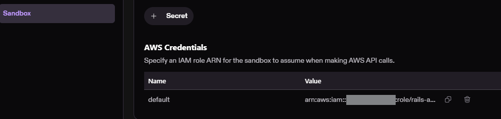

---

## 5.2 分析用 Role の責務

分析用 Role の権限は以下に限定する

- AWS 構成を見る
- Resource metadata（リソース設定など）を見る
- 依存関係を理解する

それに対して、以下の操作は禁止している

- Create
- Update
- Delete
- Terraform apply
- Secret 値の取得

---

## 5.3 信頼ポリシー（Trust Policy）

Role を「誰が Assume できるか」を、信頼ポリシー（Trust Policy）で制限する

以下のようなイメージ

```text
信頼ポリシー（Trust Policy）
= 誰がこのRoleを借りられるか

許可ポリシー（Permissions Policy）
= 借りたRoleで何ができるか
```

[kiro_discovery_assume_role (kiro.tf)](../terraform/kiro.tf)

```hcl
principals {
      type        = "Service"
      identifiers = ["q.amazonaws.com"]
}

condition {
      test     = "StringEquals"
      variable = "sts:SourceIdentity"
      values   = [var.kiro_user_id]
}
```

---

## 5.4 初期権限

最初は AWS Managed Policy の `ViewOnlyAccess` を利用し、以下の要素を中心に確認させた

- 使用リソース
- リソース設定
- メタデータ

※ `ReadOnlyAccess` を使用しない理由は、
サービスによっては実データまで読める可能性がある Policy だったため

---

# 6. 分析開始前の疎通確認

まずは AssumeRole が成功するかを確認するために、以下のコマンドを Kiro に実行させた

```bash
aws sts get-caller-identity
```

結果:

```text
assumed-role/rails-aws-sre-lab-kiro-discovery-role/...
```

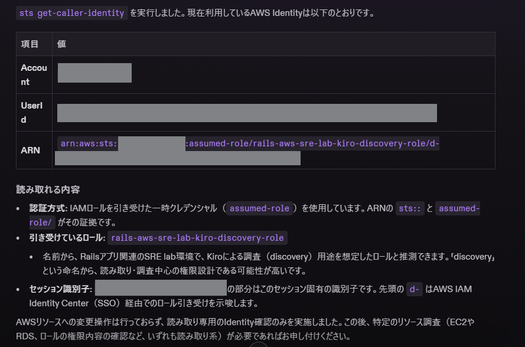

これにより、分析用 Role の AssumeRole が成功していることを確認した

---

# 7. Discovery Prompt

Kiro に既存環境の分析を指示する Prompt は GitHub で管理している

[分析用 Prompt](../kiro/prompt/11_kiro_brownfield_iac_discovery.md)

Prompt を渡した上で、Kiro に最初の指示をする

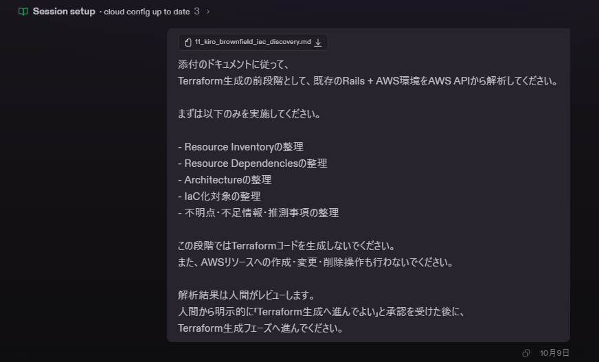

重要なのは、**環境分析 と Terraform 生成 を一気にやらせないこと** であり、
IaC の精度を高めるために、以下の要素を分離して評価している

- AWS環境を正しく理解できているか
- 環境に則した Terraform を高い精度で生成できているか

---

# 8. 初回の分析結果

## 8.1 Kiro が把握したアーキテクチャ

Kiro は AWS API のみから以下を把握した

```text
Internet
  │
  ▼
Route53
  │
  ▼
ALB
  │ 80 → 443
  │ HTTPS / ACM
  ▼
Target Group :8080
  │
  ▼
ECS Fargate
  │
  ├─ ECR
  ├─ Secrets Manager
  ├─ CloudWatch Logs
  └─ RDS PostgreSQL :5432
```

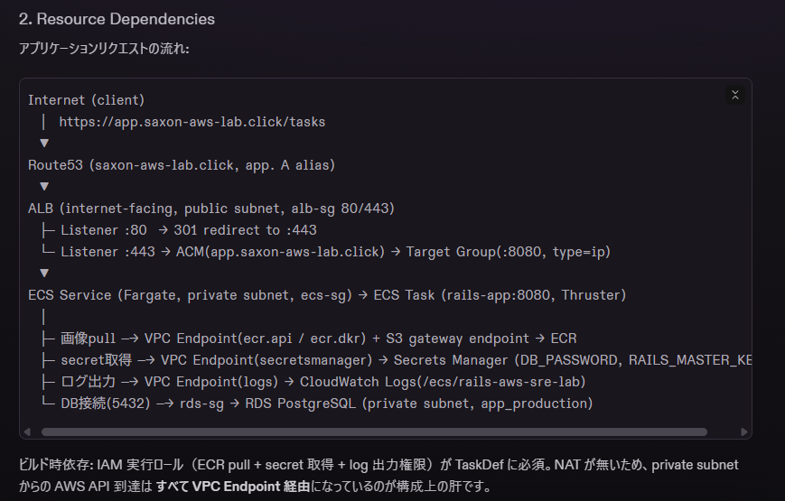

NAT Gateway が存在せず、
Private Subnet から以下を VPC Endpoint 経由で利用していることも把握できている

```text
ecr.api
ecr.dkr
logs
secretsmanager
S3 Gateway Endpoint
```

---

## 8.2 Resource Inventory

Kiro は主に以下のリソースを検出した

- VPC
- Public Subnet x2
- Private Subnet x2
- Internet Gateway
- Public / Private Route Table
- VPC Endpoints
- Security Groups
- ALB
- Listeners
- Target Group
- ECS Cluster
- ECS Service
- ECS Task Definition
- ECR
- RDS
- DB Subnet Group
- Secrets Manager references
- CloudWatch Logs
- IAM Execution Role
- Route 53
- ACM


---

## 8.3 初回分析時の調査ギャップ

`ViewOnlyAccess` だけでは、既存環境の再現に必要な一部情報を取得できなかった

拒否された代表的な API:

```text
iam:GetRole
iam:GetRolePolicy
acm:DescribeCertificate
elasticloadbalancing:DescribeRules
elasticloadbalancing:DescribeTargetGroupAttributes
ecr:DescribeImages
```

さらに Application Auto Scaling を初回分析では検出できず、
「Auto Scalingなし」と誤判定していた


---

# 9. 人間によるレビュー（調査ギャップの評価）

初回 Kiro は IAM Role の実体を読めなかったため、

```text
ecs-tasks.amazonaws.com を trust
SecretsManager GetSecretValue
kms:Decrypt
```

などを推測していたが、IAM はセキュリティに関わり、
既存環境の再現をする際にも必要な要素であるため、
「Kiro の推測を元に Terraform 化しない」方針とした

---

# 10. 分析 Policy の補完

`ViewOnlyAccess` 自体を権限の大きな `ReadOnlyAccess` に変更するのではなく、
不足している Read API の実行権限のみ追加した

```text
ViewOnlyAccess
+
必要最小限の補足Read API
```


追加対象:

### IAM

```text
iam:GetRole
iam:GetRolePolicy
iam:ListRolePolicies
iam:ListAttachedRolePolicies
iam:ListRoleTags
iam:GetPolicy
iam:GetPolicyVersion
iam:ListPolicyVersions
```

### ACM / ALB / ECR

```text
acm:DescribeCertificate
elasticloadbalancing:DescribeRules
elasticloadbalancing:DescribeTargetGroupAttributes
ecr:DescribeImages
```

### Application Auto Scaling

```text
application-autoscaling:DescribeScalableTargets
application-autoscaling:DescribeScalingPolicies
application-autoscaling:DescribeScheduledActions
application-autoscaling:DescribeScalingActivities
```

---

# 11. 再分析

補完 Policy 適用後、Kiro に不足項目の再調査をさせた

## 11.1 IAM

### Trust Policy

実測:

```json
{
  "Effect": "Allow",
  "Principal": {
    "Service": "ecs-tasks.amazonaws.com"
  },
  "Action": "sts:AssumeRole"
}
```

### Inline Policy

実測:

```text
secretsmanager:GetSecretValue
```

対象はアプリケーションが利用する2つの Secret ARN のみに限定

### 重要な修正

Kiro の初回推測:

```text
GetSecretValue
+
kms:Decrypt
```

実際:

```text
GetSecretValue のみ
```

つまり、**追加権限によって Kiro 自身が推測誤りを修正できた**

---

## 11.2 ACM

既存 Certificate:

```text
app.saxon-aws-lab.click
```

SAN:

```text
app.saxon-aws-lab.click のみ
```

Wildcard ではない

したがって新環境:

```text
kiro.saxon-aws-lab.click
```

用 Certificate は新規発行が必要と確定

---

## 11.3 ALB

Listener Rules:

```text
HTTP :80
→ default redirect HTTPS

HTTPS :443
→ default forward Target Group
```

追加の Host / Path Rule は存在しない

Target Group Attributes も実測できた

---

## 11.4 ECR

稼働 Image:

```text
tag: ff79378
architecture: ARM64 / LINUX
```

ECR Repository:

```text
IMMUTABLE
scanOnPush = true
```

---

## 11.5 Auto Scaling

再 Discovery により、初回で見逃していた Application Auto Scaling を発見

```text
Min: 1
Max: 3

Metric:
ECSServiceAverageCPUUtilization

Target:
50%

Scale Out Cooldown:
60 sec

Scale In Cooldown:
300 sec
```

これは今回の Brownfield 検証で特に重要なポイント

```text
初回:
Auto Scalingなし と誤判定

Human Review:
権限不足の可能性を指摘

Supplemental Permission:
Application Auto Scaling Describe

再Discovery:
Auto Scalingを発見
```

---

# 12. 残りの調査ギャップ

再分析後も以下は未取得だが、
今回の Terraform 化では問題にならないと判断した

```text
ecr:BatchGetImage
ecr:GetLifecyclePolicy
ecr:GetRepositoryPolicy
secretsmanager:ListSecrets
```

理由:

### `ecr:BatchGetImage`

Image Manifest の直接取得はできないが、

```text
ARM64/LINUX
active image tag
digest
```

は他 API / Task Definition から確認済み

### `ecr:GetLifecyclePolicy`

Lifecycle Policy の有無は不明

ただしアプリケーションの起動条件ではないため、新環境では別途方針決定可能

### `ecr:GetRepositoryPolicy`

Cross Account sharing 等は未確認

今回の同一アカウント内の ECS → ECR 構成では必須情報ではない

### `secretsmanager:ListSecrets`

アカウント全体の Secret 一覧は取得できない

ただし ECS Task Definition が参照する Application Secret は把握済み

---

# 13. Terraform 生成前の承認

分析結果を人間がレビューし、以下の方針を決定した

## DNS / ACM

```text
既存 Hosted Zone:
saxon-aws-lab.click

→ 再利用

新規 Record:
kiro.saxon-aws-lab.click

新規 ACM Certificate:
kiro.saxon-aws-lab.click
```

Hosted Zone 自体は新規作成しない

---

## ECR / Image

新環境用の ECR リポジトリは Terraform で新規作成する

アプリケーションの Image は Terraform 管理対象外とする

```text
既存リポジトリ:
rails-aws-sre-lab:ff79378

新規リポジトリ:
rails-aws-sre-lab-kiro:ff79378
```

Kiro が新規リポジトリ作成後、
人間が新リポジトリに Image を投入する運用にする

---

## GitHub

Kiro が生成した Terraform は、以下のプロジェクトで管理する

- Saxon-Pi/rails-aws-sre-lab-kiro
  - https://github.com/Saxon-Pi/rails-aws-sre-lab-kiro

Kiro は以下の流れで IaC 化作業を進める

```text
clone
↓
feature branch
↓
Terraform 生成
↓
fmt
↓
validate
↓
plan
↓
commit
↓
push
↓
Pull Request
```

default branch への直接 push / merge は禁止

---

# 14. Kiro による Terraform 生成

Kiro は GitHub リポジトリを clone し、以下のブランチを作成した

- [feat/kiro-env-terraform](https://github.com/Saxon-Pi/rails-aws-sre-lab-kiro/tree/feat/kiro-env-terraform)

リソース単位で Terraform を生成している

```text
terraform/
├─ acm.tf
├─ alb.tf
├─ ecr.tf
├─ ecs.tf
├─ iam.tf
├─ monitoring.tf
├─ network.tf
├─ outputs.tf
├─ providers.tf
├─ rds.tf
├─ route53.tf
├─ secrets.tf
├─ security_group.tf
├─ variables.tf
└─ versions.tf
```

---

# 15. Kiro の Terraform Validation 【要確認】

Kiro Sandbox では `registry.terraform.io` への通信に失敗した

一方で、

```text
releases.hashicorp.com
```

には到達可能であったため、
Kiro は自律的に filesystem mirror を構築し、AWS Provider を取得して `terraform init` を成功させた

結果:

```text
terraform fmt
→ Success

terraform validate
→ Success

terraform plan
→ Plan: 49 to add, 0 to change, 0 to destroy
```

※ Terraform Apply は実行していない

---

# 16. GitHub PR

Kiro が自動作成

[PR #1 feat: Terraform for isolated kiro environment (brownfield IaC)](https://github.com/Saxon-Pi/rails-aws-sre-lab-kiro/pull/1)

```text
18 files changed
1171 additions
0 deletions
```

Kiro Agent が Author であり、以下は未実施
- terraform apply
- AWS resource mutation

---

# 17. オリジナル Terraform vs Kiro 生成 Terraform

## 17.1 Application Runtime Infrastructure

総じて、Application Runtime Layer の再現精度は非常に高い

| Category | Original | Kiro | 評価 |
|---|---:|---:|---|
| VPC | ✅ | ✅ | 高い再現 |
| Public Subnet x2 | ✅ | ✅ | 高い再現 |
| Private Subnet x2 | ✅ | ✅ | 高い再現 |
| IGW | ✅ | ✅ | 高い再現 |
| NAT-less | ✅ | ✅ | 一致 |
| S3 Gateway Endpoint | ✅ | ✅ | 一致 |
| ECR API Endpoint | ✅ | ✅ | 一致 |
| ECR DKR Endpoint | ✅ | ✅ | 一致 |
| Logs Endpoint | ✅ | ✅ | 一致 |
| Secrets Manager Endpoint | ✅ | ✅ | 一致 |
| ALB SG | ✅ | ✅ | 一致 |
| ECS SG | ✅ | ✅ | 一致 |
| RDS SG | ✅ | ✅ | 一致 |
| VPCE SG | ✅ | ✅ | 一致 |
| ECR | ✅ | ✅ | 高い再現 |
| ECS Cluster | ✅ | ✅ | 一致 |
| ECS Fargate | ✅ | ✅ | 一致 |
| ARM64 | ✅ | ✅ | 一致 |
| CPU 256 / Memory 512 | ✅ | ✅ | 一致 |
| ALB | ✅ | ✅ | 一致 |
| Health Check `/tasks` | ✅ | ✅ | 一致 |
| RDS PostgreSQL | ✅ | ✅ | 高い再現 |
| Secrets Manager | ✅ | ✅ | 高い再現 |
| Execution Role | ✅ | ✅ | 高い再現 |
| CloudWatch Logs | ✅ | ✅ | 一致 |
| Auto Scaling Min1/Max3 | ✅ | ✅ | 一致 |
| CPU Target 50% | ✅ | ✅ | 一致 |
| Route53 | ✅ | ✅ | 新サブドメイン向けに適切に変更 |
| ACM | ✅ | ✅ | 新サブドメイン向けに適切に変更 |

---

## 17.2 Operations / Observability Layer

Kiro が生成していないもの:

```text
CloudWatch Dashboard
CloudWatch Metric Alarm
SNS Topic
Slack Chatbot
ECS EventBridge Capture
AWS DevOps Agent
```

これは今回の目的:

```text
Web ApplicationとしてECS環境を再構築する
```

には必須ではない

したがって本検証では、

```text
不足
```

ではなく、

```text
Out of Scope / Operations Layer
```

として評価する

---

# 18. Original Terraform と異なる重要ポイント

## 18.1 Provider Version

Original:

```hcl
terraform >= 1.10
AWS Provider ~> 6.0
```

Kiro Generated:

```hcl
terraform >= 1.5
AWS Provider ~> 5.60
```

Kiro Sandbox で取得可能な Provider を使ったことが理由

Application 動作には直接影響しない可能性が高いが、最終形では Provider version をどうするか Human Review が必要

---

## 18.2 `.terraform.lock.hcl`

Kiro 版は `.terraform.lock.hcl` を `.gitignore` している

再現性の観点では通常、Provider Lock File は Git 管理した方が望ましい

Deploy 前に通常ネットワーク環境で:

```bash
terraform init
```

を実行し、lock file を生成して commit するか検討する

---

## 18.3 ECS Lifecycle

Original Terraform は CI/CD が Task Definition Revision を更新するため、

```hcl
ignore_changes = [
  task_definition
]
```

を利用

Kiro Generated は、

```hcl
ignore_changes = [
  desired_count
]
```

を利用

これは Auto Scaling が Desired Count を管理するため合理的

ただし Kiro 環境で将来 CI/CD を導入する場合、

```text
Task Definitionを誰が管理するのか
```

を再設計する必要がある

---

## 18.4 Live Environment と Original Terraform の差

既存 Terraform の Task Definition image tag と、AWS 上で実際に稼働していた image tag は異なる

これは GitHub Actions 側が Task Definition Revision を更新し、Terraform がその差分を ignore する構成のため

Kiro は Terraform ではなく **AWS 実環境を Source of Truth** として解析したため、実稼働 image tag を取得した

これは Brownfield Discovery の利点の一つ

---

# 19. Kiro の精度評価

## 19.1 現時点の評価

| 領域 | 評価 | コメント |
|---|---|---|
| Networking | 高 | NAT-less / Endpoint 構成まで再現 |
| Security Group | 高 | SG chain を正確に再現 |
| ECS | 高 | ARM64 / Port / Env / Secret / Logs を再現 |
| RDS | 高 | Engine / Class / Storage / Secret連携を再現 |
| IAM | 高 | Supplemental Discovery 後は実体に基づき再現 |
| ALB | 高 | Listener / TG / Health Check を再現 |
| DNS / TLS | 高 | 既存 Zone再利用 + 新Certを判断 |
| Auto Scaling | 高 | 初回見逃し後、再Discoveryで正確に再現 |
| ECR | 高 | Repo設定 + Runtime tag把握 |
| Observability | 部分的 | CloudWatch LogsのみDashboard/AlarmはScope外 |
| Operations | Scope外 | Slack / EventBridge / DevOps Agent未生成 |

---

## 19.2 特に良かった点

### AWS API のみから Dependency を復元

```text
ALB
→ ECS
→ RDS
```

だけでなく、

```text
ECS
→ ECR
→ S3 Gateway
→ Secrets Manager
→ CloudWatch Logs
```

まで把握

### IAM の推測誤りを再調査で自己修正

```text
推測:
kms:Decryptあり

実測:
なし
```

### Auto Scaling を追加権限後に発見

権限不足を Human がレビューし、Kiro が再 Discovery することで精度向上

### Sandbox制約を自己解決

Terraform Registry が使えない状況で filesystem mirror を構築し、Plan まで到達

### GitHub Workflow

TerraformをSandbox内だけに残さず、

```text
branch
commit
push
PR
```

まで実施

---

# 20. Human Intervention 一覧

現時点で人間が介入したポイント

| # | Human Intervention | 理由 |
|---|---|---|
| 1 | Kiro / GitHub 接続 | Initial setup |
| 2 | Discovery Role作成 | AWS権限境界 |
| 3 | NetworkをCommon dependenciesへ変更 | AWS API 403 |
| 4 | Supplemental Read Policy追加 | IAM/ACM/AutoScaling等のGap |
| 5 | Discovery結果レビュー | 推測と事実を分離 |
| 6 | DNS/ACM方針決定 | Existing Hosted Zone再利用 |
| 7 | ECR Artifact方針決定 | ImageをTerraform管理外にする |
| 8 | Secret値をHuman-managedと決定 | Security / 汎用性 |
| 9 | Terraform Generation承認 | Human Gate |
| 10 | Backend方針決定 | State separation |
| 11 | Deployment Role設計 | Deploy権限境界 |
| 12 | Apply最終承認 | 今後実施 |

この一覧は「Kiroだけで全部できた」と誤解させないために重要

---

# 21. Secret / Artifact Responsibility

今回、実務でも再利用しやすい責務分離として以下を採用する

```text
Infrastructure
→ Kiro-managed

Terraform
→ Kiro-generated / Human-reviewed

Docker Image
→ Human-managed

Secret Resource
→ Kiro-managed

Secret Value
→ Human-managed

Apply execution
→ Kiro

Apply approval
→ Human

Final acceptance
→ Human
```

理由:

- 環境ごとに異なる Image を利用する可能性がある
- 環境ごとに異なる Secret を利用する可能性がある
- Kiro に既存 Secret 値を読ませる必要をなくす
- Secret leakage risk を小さくする
- Application Artifact と Infrastructure の責務を分離できる

---

# 22. RAILS_MASTER_KEY とは

Rails には暗号化された Credential Store がある

```text
config/credentials.yml.enc
```

このファイルの中には Application Secret を保存できる

例:

```text
API key
外部サービスCredential
Rails secret
その他Application設定
```

`credentials.yml.enc` を復号する鍵が:

```text
RAILS_MASTER_KEY
```

である

## 重要

`RAILS_MASTER_KEY` は Docker Image 全体を暗号化する鍵ではない

```text
RAILS_MASTER_KEYが守るもの
→ credentials.yml.enc の内容

RAILS_MASTER_KEYが守らないもの
→ Docker Imageそのもの
→ Ruby Source Code
→ Image Pull
→ Image展開
```

イメージ:

```text
Docker Image
│
├─ Rails Source
│
└─ credentials.yml.enc  ← 暗号化された金庫
          ▲
          │ decrypt
          │
    RAILS_MASTER_KEY     ← 金庫の鍵
```

Fargate 起動時:

```text
Secrets Manager
     │
     │ RAILS_MASTER_KEY
     ▼
ECS Task
     │
     ▼
Rails Boot
     │
     ▼
credentials.yml.enc decrypt
```

今回同じ Docker Image を利用する場合、Image 内の `credentials.yml.enc` も同じため、対応する同じ `RAILS_MASTER_KEY` が必要

---

# 23. Terraform State 方針

既存 S3 Backend Bucket を再利用し、Object Key だけ分離する

```text
s3://rails-aws-sre-lab-terraform-state/

├─ terraform.tfstate
│   └─ Existing Environment
│
└─ kiro/
    └─ terraform.tfstate
        └─ Kiro Environment
```

Kiro environment Backend:

```hcl
terraform {
  backend "s3" {
    bucket       = "rails-aws-sre-lab-terraform-state"
    key          = "kiro/terraform.tfstate"
    region       = "ap-northeast-1"
    encrypt      = true
    use_lockfile = true
  }
}
```

`kiro/` は S3 上の物理 Folder を事前作成する必要はない

Object Key:

```text
kiro/terraform.tfstate
```

として保存される

---

# 24. Discovery Role と Deployment Role の分離

## Discovery Phase

```text
Kiro Sandbox AWS Credentials
        ↓
kiro_discovery_role
```

権限:

```text
Read-only
```

---

## Deployment Phase

```text
Kiro Sandbox AWS Credentials
        ↓
kiro_deployment_role
```

権限:

```text
新Kiro環境のResource作成/更新
Terraform State
必要なData Source Read
```

ただし以下は Kiro に許可しない方針

```text
Existing RAILS_MASTER_KEY GetSecretValue
New Secret value自動投入
Existing Application Image自動コピー
```

これらは Human-managed とする

---

## Session Separation

Roleを同時に利用させない

```text
Discovery Session
AWS Credentials = kiro_discovery_role

        ↓ Human Gate

Deploy Session
AWS Credentials = kiro_deployment_role
```

Deploy終了後:

```text
kiro_deployment_role
        ↓
Discovery Roleへ戻す
または
AWS Credentials解除
```

---

# 25. 今後の Deployment Runbook

ここからは **未実施**

実際の作業時に本ドキュメントを更新する

---

## Step 1. `kiro_deployment_role` 作成 — Human

Terraform で作成

目的:

```text
Kiroが新環境をTerraform Applyできる
```

必要権限:

- Kiro環境の VPC / EC2 Networking
- ECS
- ECR Repository
- ALB
- RDS
- IAM
- Secrets Manager Resource
- CloudWatch Logs
- Route53 Record
- ACM
- Application Auto Scaling
- S3 Terraform Backend

最小権限化を検討

Terraform State については可能であれば:

```text
rails-aws-sre-lab-terraform-state/kiro/*
```

に限定する

### Human Review

```text
terraform fmt
terraform validate
terraform plan
```

期待:

```text
Deployment Role関連のみ add
Existing Application Infrastructure change/destroyなし
```

---

## Step 2. Deploy Session 作成 — Human

Kiro Settings:

```text
AWS Credentials
Discovery Role
        ↓
Deployment Role
```

新しい Kiro Session を開始

最初に Kiro 自身に確認させる

```bash
aws sts get-caller-identity
```

期待:

```text
assumed-role/...kiro-deployment-role/...
```

---

## Step 3. Prerequisite Infrastructure 作成 — Kiro

ここでは Human が、

```text
「ECRだけ作って」
「Secretだけ作って」
```

と答えを直接教えない

Kiro に依存関係を分析させる

指示方針:

```text
本Deployに必要な前提Infrastructureを作成してください

Application固有のArtifactまたはSecret値が必要になった場合、
既存環境から自動取得・コピーしないでください

Humanによる設定が必要な項目、
投入先、
期待する形式を整理して提示し、
その時点で処理を停止してください
```

Kiro に:

```text
何を先に作るべきか
どこでHuman Gateが必要か
```

を判断させる

### 期待される結果

例:

```text
ECR Repository作成済み
Secrets Manager Secret Resource作成済み

Human Action Required:
- ImageをECRへpush
- RAILS_MASTER_KEYをSecretへ設定
```

ただし、実際に何を要求するかは Kiro の判断も評価対象とする

---

## Step 4. Application Artifact / Secret 投入 — Human

Kiro の要求内容を確認

今回想定:

### ECR

Existing:

```text
rails-aws-sre-lab:ff79378
```

を New Repository に投入

例:

```text
rails-aws-sre-lab-kiro:ff79378
```

### Secrets Manager

Kiro が作成した Secret Resource に:

```json
{
  "RAILS_MASTER_KEY": "<VALUE>"
}
```

を安全に投入

Secret値を:

```text
Git
Terraform
Chat
Blog
Screenshot
```

に残さない

---

## Step 5. Prerequisite Check + Full Deploy — Kiro

Human:

```text
Application Artifact / Secret の設定完了
```

を Kiro に通知

Kiro はまず前提確認

確認対象例:

```text
ECR image存在
Secret version存在
Backend接続
Terraform State正しい
AWS Identity正しい
```

その後:

```text
terraform fmt
terraform validate
terraform plan
```

Human Review

Plan に:

```text
destroy
replace
unexpected update
```

がないことを確認

明示的な Apply Approval 後:

```text
terraform apply
```

---

## Step 6. Deployment Validation — Kiro

Kiro に確認させる

```text
RDS status
ECS service status
ECS task running
Target Group health
ALB
ACM
Route53
CloudWatch Logs
```

最終URL:

```text
https://kiro.saxon-aws-lab.click/tasks
```

HTTP 200 を確認

---

## Step 7. Final Acceptance — Human

Kiro の報告だけに依存しない

Human が独立して確認

### Browser

```text
https://kiro.saxon-aws-lab.click/tasks
```

期待:

- HTTPS正常
- Rails Task画面表示
- HTTP 200
- CRUD等が必要なら動作確認

### AWS Console

- ECS Service stable
- Task healthy
- Target healthy
- RDS available
- Logs出力
- DNS正しい

---

## Step 8. Deployment Role解除 — Human

検証終了後:

```text
Kiro AWS Credentials
kiro_deployment_role
        ↓
kiro_discovery_role
```

または AWS Credential 設定を解除

必要であれば `kiro_deployment_role` 自体も削除

---

# 26. Kiro Deployment Prompt の設計方針

実際の Prompt では以下を明記する

## 禁止

```text
Existing Secret値を勝手に取得しない
Existing Imageを勝手にコピーしない
Human ApprovalなしでFull Applyしない
Existing Environmentを変更しない
Existing Terraform Stateを利用しない
```

## 必須

```text
Human Actionが必要になったら停止
必要項目を列挙
投入先を提示
期待形式を提示
Human完了後に再確認
PlanをHuman Reviewに提示
Applyは明示承認後
```

---

# 27. Terraform初回Deployの論点

現在の Generated Terraform は単一 Root Module に:

```text
ECR
Secret Resource
ECS
ALB
RDS
...
```

が含まれる

しかし初回 ECS 起動前には:

```text
ECR Image
RAILS_MASTER_KEY
```

が必要

したがって初回 Deploy の段階化が必要

考えられる方法:

- `terraform apply -target` をBootstrap時のみ利用
- Terraform構成をBootstrap / Applicationに分離
- `count` / flagによる段階Deploy
- Kiroが別の安全な方法を提案

ここは Human が答えを与えすぎず、**Kiroに設計させる評価ポイント**とする

---

# 28. Apply 前の追加 Review 項目

現在 PR #1 に対する主な Review Point

## Backend

```text
S3:
rails-aws-sre-lab-terraform-state

Key:
kiro/terraform.tfstate
```

へ確定する

## Provider

Original:

```text
Terraform >= 1.10
AWS Provider ~> 6.0
```

Kiro:

```text
Terraform >= 1.5
AWS Provider ~> 5.60
```

統一するか判断

## Lock File

`.terraform.lock.hcl` を Git 管理するか判断

## Bootstrap

Image / Secret投入前に ECS Service を起動しない方法を確定

## CIDR

```text
10.20.0.0/16
```

が他環境と重複しないことを確認

---

# 29. Cost / Credits 記録

## Kiro

| Phase | Credits | 備考 |
|---|---:|---|
| Start | 0 | |
| Connectivity Test | TBD | |
| Discovery #1 | TBD | |
| Discovery #2 | TBD | |
| Terraform Generation | TBD | |
| Plan / Fix | TBD | |
| Deployment | TBD | |
| Total | TBD | |

---

## AWS

新環境で費用が発生する主な Resource:

- ALB
- RDS
- ECS Fargate
- Interface VPC Endpoint x4
- CloudWatch Logs
- Secrets Manager
- Route53 Record
- ECR Storage

検証終了後の Cleanup も手順化する

---

# 30. Cleanup Runbook

検証完了後、必要に応じて新環境を削除

```text
Human Review
↓
Kiro Deployment Role
↓
terraform plan -destroy
↓
destroy対象を確認
↓
terraform destroy
```

注意:

- Existing Hosted Zone を削除しない
- Existing Application Environment を削除しない
- Existing Terraform State を削除しない
- `kiro/terraform.tfstate` だけが対象
- Human-managed Artifact / Secret の扱いを確認

Destroy 完了後:

```text
Kiro Deployment Role削除
Kiro Sandbox AWS Credentials解除
Temporary IAM Policy削除検討
```

---

# 31. 実務で再利用する場合の標準フロー

今回の知見から、Brownfield IaC の標準フロー候補は以下

```text
1. 専用Repo作成
2. Kiro GitHub Accessを専用Repoだけに制限
3. Discovery Read-only Role作成
4. Kiro Discovery
5. Human Review
6. Missing Read APIのみ追加
7. Kiro Re-Discovery
8. Human Review
9. IaC Generation Approval
10. Terraform Generate / Validate / Plan
11. GitHub PR
12. Human Security Review
13. Deployment Role作成
14. Deploy Session分離
15. Prerequisite Infrastructure作成
16. HumanがArtifact / Secret投入
17. Full Plan
18. Human Approval
19. Apply
20. Kiro Validation
21. Human Acceptance
22. Deployment Role解除
23. Cleanup
```

---

# 32. 現時点の結論

現時点ではまだ Deploy 完了前だが、Terraform Generation までの検証では以下が確認できた

### Kiro が自律的にできたこと

- AWS Resource Discovery
- Dependency解析
- Architecture復元
- 不明点の明示
- Terraform生成
- Resource分割
- fmt
- validate
- plan
- Sandbox network制約の回避
- Git branch
- commit
- push
- Pull Request
- Supplemental権限後の再調査
- 自身の初回推測の修正

### Human が必要だったこと

- IAM / Network の Guardrail設計
- Discovery精度のReview
- 追加Read Permission判断
- Scope判断
- DNS / ACM設計判断
- Artifact / Secret責務判断
- State Backend判断
- Deploy権限境界
- Apply Approval
- 最終 Acceptance

現時点の印象としては、

> **Kiro は Brownfield AWS 環境を高い精度で Infrastructure as Code に再構築できるが、Security Boundary・Secret・Artifact・Apply判断といった責任境界は Human が明示的に設計する必要がある**

最終的な評価は Deployment 完了後に更新する

---

# 33. ブログ記事へ展開する場合の構成案

## タイトル候補

```text
Kiroに既存AWS環境だけを見せてTerraformを再生成させた
```

または:

```text
既存Terraformを見せずにKiroはAWS環境をIaC化できるのか？
```

---

## 記事構成

1. なぜこの検証をしたか
2. 既存AWS環境
3. 既存Terraformを隠した理由
4. Kiro Sandbox / IAM設計
5. 最初のDiscovery
6. ViewOnlyAccessでは足りなかった
7. Human Reviewで権限を追加
8. Auto Scalingを再発見
9. Terraformを生成
10. Original vs Kiro比較
11. GitHub PRまで自動化
12. Secret / ArtifactはHuman管理にした理由
13. Deploy Roleを分離する理由
14. 実際にDeploy
15. どこまでKiroだけでできたか
16. Credits / Cost
17. 実務で使うならどうするか
18. 最終評価

---

# 34. 画像候補一覧

公開版で利用する場合はマスキング済み画像を用意する

| # | 画像 | 挿入候補 |
|---|---|---|
| 1 | Kiro GitHub App Repository restriction | §4 |
| 2 | Kiro Sandbox AWS Credentials | §5 |
| 3 | `sts get-caller-identity` | §6 |
| 4 | Repository access only 403 | §4.3 |
| 5 | Common dependencies設定 | §4.3 |
| 6 | 初回Discovery結果 | §8 |
| 7 | Supplemental IAM Plan | §10 |
| 8 | 再Discovery: IAM実体 | §11 |
| 9 | 再Discovery: Auto Scaling発見 | §11.5 |
| 10 | Terraform Plan 49 add / 0 change / 0 destroy | §15 |
| 11 | GitHub PR #1 | §16 |
| 12 | Deployment Role | 今後 |
| 13 | Bootstrap Human Gate | 今後 |
| 14 | ECS Healthy / Target Healthy | 今後 |
| 15 | `kiro.saxon-aws-lab.click/tasks` | 最終結果 |
| 16 | Kiro Credits Final | 最終結果 |

---

# 35. 今後追記する内容

- [ ] `kiro_deployment_role` Terraform
- [ ] Deployment Role Plan結果
- [ ] Kiro Deploy Prompt
- [ ] Deploy Session切替結果
- [ ] Bootstrap方式
- [ ] KiroからHumanへの依頼内容
- [ ] ECR Image投入手順
- [ ] RAILS_MASTER_KEY投入手順
- [ ] Full Plan
- [ ] Full Apply
- [ ] ECS Deployment結果
- [ ] Target Health
- [ ] HTTPS / HTTP 200
- [ ] Credits
- [ ] AWS Cost
- [ ] Original vs Kiro最終比較
- [ ] Human Intervention最終集計
- [ ] Cleanup
- [ ] 最終所感
